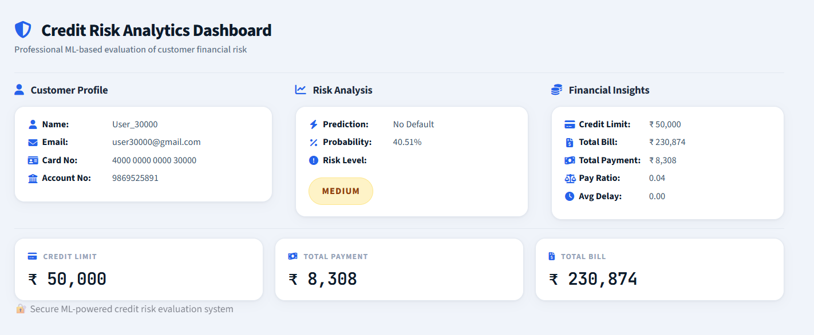

# 💳 Credit Card Default Risk Prediction System

A machine learning-powered web application that predicts the likelihood of credit card default and provides an interactive dashboard for risk assessment and financial analysis.

---

# 🚀 Features

### Secure Authentication
Provides a login-based access system for users to securely view their financial risk information. Authentication ensures controlled access to customer-specific data.

### Credit Risk Prediction
Uses a trained machine learning model to predict the probability of credit card default. Predictions are generated using customer financial and payment history.

### Risk Probability Analysis
Calculates default probability scores to quantify customer risk levels. This helps users understand their financial standing more effectively.

### Risk Classification
Categorizes customers into Low, Medium, or High risk groups based on prediction probability. The classification enables quick and intuitive risk interpretation.

### Financial Insights Dashboard
Displays key financial indicators such as credit limit, bill amount, payment amount, and repayment behavior. These metrics provide meaningful insights into customer finances.

### Interactive User Interface
Built using Streamlit to deliver a clean, responsive, and user-friendly experience. The interface is designed for easy navigation and data interpretation.

---

# 🛠️ Technology Stack

### Programming Language
- Python

### Frontend Framework
- Streamlit

### Data Processing
- Pandas
- NumPy

### Machine Learning
- Scikit-Learn

### Model Serialization
- Joblib

### Version Control
- Git
- GitHub

### Cloud Deployment
- Streamlit Community Cloud

---

# 📊 Machine Learning Workflow

### Data Preprocessing
Data cleaning and preparation techniques are applied to improve dataset quality. Relevant features are selected and transformed for model training.

### Feature Engineering
Additional financial indicators are derived to enhance predictive performance. These features provide deeper insights into customer behavior.

### Feature Scaling
Numerical attributes are standardized before model training. Scaling ensures consistent feature contribution across the model.

### Model Training
The machine learning model learns patterns associated with customer default behavior. Historical financial records are used to build predictive capability.

### Risk Prediction
The trained model generates default predictions and probability scores. Results are displayed through an interactive dashboard.

### Deployment
The application is deployed on Streamlit Community Cloud for public access. Deployment enables real-time interaction with the model through a web interface.

---

# 🎯 Risk Classification

| Risk Level | Description |
|------------|-------------|
| High Risk | Customers with a high probability of default requiring immediate attention. |
| Medium Risk | Customers showing moderate financial risk indicators. |
| Low Risk | Customers demonstrating stable repayment behavior and low default probability. |

---

# 📈 Dashboard Metrics

### Credit Limit
Represents the maximum borrowing capacity assigned to a customer. It provides insight into available credit resources.

### Total Bill Amount
Displays the cumulative billing amount across multiple billing cycles. It reflects overall customer liabilities.

### Total Payment Amount
Represents the total amount repaid by the customer. This metric helps evaluate repayment consistency.

### Payment Ratio
Measures the relationship between payments made and outstanding bills. Higher values generally indicate healthier repayment behavior.

### Average Delay
Calculates the average delay in customer payments. It serves as an indicator of repayment discipline.

### Risk Probability
Displays the predicted likelihood of customer default. This value supports informed financial risk assessment.

---

# ⚙️ Installation & Setup

### Clone the Repository

```bash
git clone <repository-url>
cd credit-card-prediction
```

### Create a Virtual Environment

```bash
python -m venv .venv
```

### Activate the Virtual Environment

#### Windows

```bash
.venv\Scripts\activate
```

#### Linux / macOS

```bash
source .venv/bin/activate
```

### Install Dependencies

```bash
pip install -r requirements.txt
```

### Run the Application

```bash
streamlit run app.py
```

### Access the Application

Open your browser and navigate to:

```text
http://localhost:8501
```

---

# 📚 Resources Used

### Dataset
- Credit Card Default Dataset from Kaggle

### Open Source Libraries
- Streamlit
- Pandas
- NumPy
- Scikit-Learn
- Joblib

### Development Tools
- Visual Studio Code
- PyCharm
- Git
- GitHub

---

# 📁 Project Structure

```text
credit-card-prediction/
│
├── app.py
├── login.py
├── dashboard.py
├── requirements.txt
├── credit_default_model.pkl
├── scaler.pkl
│
├── Dataset/
│   ├── Credentials.csv
│   └── default of credit card clients.csv
│
└── README.md
```

---

# 🔒 Security & Privacy Notice

This application is developed solely for educational, research, and demonstration purposes.

All customer profiles, credentials, email addresses, account numbers, and card numbers used within the project are synthetic data created for testing purposes and do not represent real individuals or financial accounts.

---

## 📊 Dashboard Preview



## LiveDemo:
https://credit-card-prediction-koyg.onrender.com
---


# 👨‍💻 Author

**Vibinson Raj G**

---

# 📄 License

Copyright © 2026 Vibinson Raj G. All Rights Reserved.

This project is provided for educational and portfolio purposes only. Unauthorized copying, modification, distribution, or commercial use of this project without prior permission is prohibited.

---

