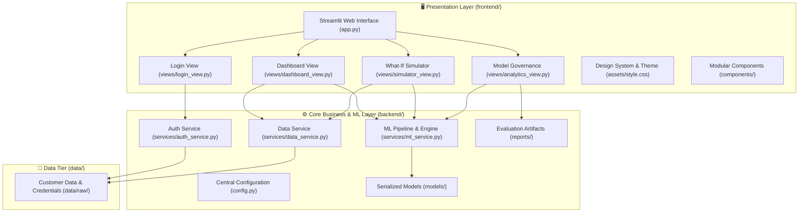

# 💳 Credit Risk Intelligence & Default Prediction Platform

[](https://www.python.org/)
[](https://streamlit.io/)
[](https://scikit-learn.org/)
[](#-license)

An enterprise-grade Machine Learning platform designed for financial institutions to assess credit card delinquency risk, evaluate default probabilities, simulate credit adjustment scenarios, and provide automated credit governance.

---

## 🏛️ System Architecture

The application adopts a clean, decoupled **Frontend / Backend** architectural pattern:



---

## 🚀 Key Features

### 1. 🔐 Enterprise Authentication & 1-Click Demo Personas
- Multi-factor styled login screen with secure credential validation.
- **1-Click Demo Profiles**: Pre-calibrated evaluator personas (Low Risk, Medium Risk, High Risk) for instant testing without manual typing.

### 2. 🛡️ Real-Time Credit Default Prediction
- High-performance, SMOTE-balanced Random Forest classifier tuned via GridSearchCV.
- Calibrated probability estimation with custom optimal decision boundary ($0.45$).
- Tiered risk classification:
  - 🟢 **Low Risk**: $P(\text{Default}) < 0.45$
  - 🟡 **Medium Risk**: $0.45 \le P(\text{Default}) < 0.70$
  - 🔴 **High Risk**: $P(\text{Default}) \ge 0.70$

### 3. 🔮 Interactive "What-If" Credit Scenario Simulator
- Enables credit officers and customers to simulate real-time adjustments:
  - Prospective lump-sum payment towards outstanding balances.
  - Credit line expansion or reduction factors.
  - Payment delay delinquency shifts.
- Immediate side-by-side risk score recalculation and net probability delta.

### 4. 📈 Financial Timeseries & Analytics
- 6-month historical billing vs repayment trajectory comparison.
- Delinquency trend tracker with on-time baseline indicators.
- Interactive revolving credit utilization and default probability gauges.

### 5. 🔬 Model Governance & Explainability
- ROC-AUC comparative curves across candidate architectures.
- Confusion matrix benchmarks (Random Forest vs XGBoost vs Logistic Regression).
- Global feature importance attribution (Gini impurity).
- Population-level risk distribution histogram.

---

## 📁 Clean Project Structure

```text
ML Project/
│
├── app.py                      # Application entrypoint (`streamlit run app.py`)
├── run.py                      # Convenience CLI launcher (`python run.py`)
├── requirements.txt            # Production dependencies (UTF-8)
├── README.md                   # System documentation & architectural reference
│
├── backend/                    # Core business logic, data access & ML pipeline
│   ├── config.py               # Central paths, hyperparams, risk thresholds
│   ├── services/
│   │   ├── auth_service.py     # Authentication, credentials & session state
│   │   ├── data_service.py     # Cached datasets loading & record lookup
│   │   └── ml_service.py       # Preprocessor, feature engineering, inference & simulator
│   ├── models/                 # Serialized ML artifacts
│   │   ├── credit_default_model.pkl
│   │   ├── scaler.pkl
│   │   └── feature_columns.pkl
│   └── reports/                # Evaluation reports & figures
│       ├── customer_risk_report.csv
│       └── figures/
│           ├── confusion_matrix_*.png
│           ├── roc_curve_comparison.png
│           ├── feature_importance.png
│           └── risk_distribution.png
│
├── frontend/                   # Presentation layer & user interface
│   ├── assets/
│   │   ├── style.css           # Modern enterprise fintech design system
│   │   └── img.png             # Dashboard preview
│   ├── components/             # Reusable UI modules
│   │   ├── header.py           # Top navbar & CSS injection
│   │   ├── sidebar.py          # Navigation menu, profile card & model info
│   │   ├── kpi_cards.py        # Executive summary & metric cards
│   │   └── charts.py           # Plotly charts & radial gauges
│   └── views/                  # Screen views
│       ├── login_view.py       # Authentication portal with 1-click demo accounts
│       ├── dashboard_view.py   # Primary credit risk intelligence dashboard
│       ├── simulator_view.py   # Interactive "What-If" credit scenario simulator
│       └── analytics_view.py   # Model governance & ML performance analytics
│
├── data/                       # Data repository
│   └── raw/
│       ├── Credentials.csv
│       └── default of credit card clients.csv
│
└── notebooks/                  # Model research & training workflows
    └── ML Application.ipynb
```

---

## ⚙️ Installation & Quickstart

### 1. Prerequisites
- Python 3.10+ (tested through Python 3.14)
- Git

### 2. Setup Environment

```bash
# Clone the repository
git clone https://github.com/vibinson05/Credit-Card-Prediction.git
cd "ML Project"

# Create virtual environment
python -m venv .venv

# Activate virtual environment
# Windows (PowerShell):
.venv\Scripts\Activate.ps1
# Windows (CMD):
.venv\Scripts\activate.bat
# Linux / macOS:
source .venv/bin/activate

# Install dependencies
pip install -r requirements.txt
```

### 3. Launch the Application

```bash
streamlit run app.py
```
*Alternatively, run:*
```bash
python run.py
```

Open your browser at `http://localhost:8501`.

---

## ⚡ Demo Credentials for Instant Review

| Persona | Customer ID | Email | Password | Risk Profile |
|---------|-------------|-------|----------|--------------|
| **Low Risk** | `7` | `user7@gmail.com` | `WlCg0wdYVB` | 🟢 11.2% Default Prob |
| **Medium Risk** | `20` | `user20@gmail.com` | `tt5KDq8Ym4` | 🟡 50.1% Default Prob |
| **High Risk** | `1` | `user1@yahoo.com` | `HRqNUsQcnA` | 🔴 75.5% Default Prob |

> 💡 **Tip**: You can click the **1-Click Demo Profile** buttons directly on the login screen to sign in instantly!

---

## 🛠️ Technology Stack

- **Application & UI**: [Streamlit](https://streamlit.io/), [Plotly](https://plotly.com/python/)
- **Machine Learning**: [Scikit-Learn](https://scikit-learn.org/), [Imbalanced-Learn (SMOTE)](https://imbalanced-learn.org/), [XGBoost](https://xgboost.readthedocs.io/)
- **Data Engineering**: [Pandas](https://pandas.pydata.org/), [NumPy](https://numpy.org/)
- **Styling**: Modern CSS3 (Inter, JetBrains Mono, Flexbox/Grid)

---

## 🔒 Security & Synthetic Data Disclosure

This application is strictly for portfolio, educational, and demonstration purposes. All customer records, credentials, card numbers, and account identifiers are synthetic and do not correspond to real individuals or active financial accounts.

---

## 👨‍💻 Author

**Vibinson Raj G**  
*Machine Learning & Software Engineer*  
- Portfolio / Live Demo: [Credit Risk Intelligence Platform](https://credit-card-prediction-koyg.onrender.com)
- GitHub: [@vibinson05](https://github.com/vibinson05)

---

## 📄 License

Copyright © 2026 Vibinson Raj G. All Rights Reserved.  
Provided for portfolio demonstration and educational evaluation.
"# Credit-Default-Prediction" 
"# Credit-Default-Prediction" 
